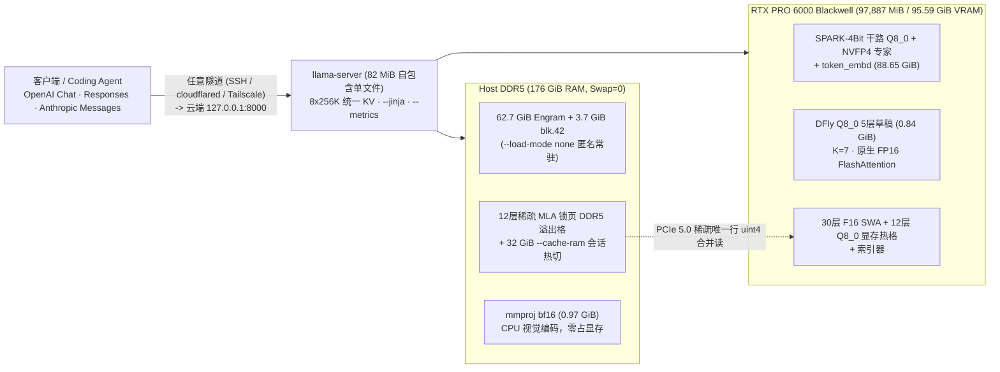

# hy4-flash-colab-g4

> 一份已经趟平所有硬坑的 **Google Colab G4**（`RTX PRO 6000 Blackwell Server Edition`, `97,887 MiB / 95.59 GiB VRAM`）纯 C++/CUDA 推理配方：在单卡零容器环境下满血运行 **Tencent Hy4-Flash**（清洁 `SPARK-4Bit` 权重 + `DFly K=7` 投机解码 + 草稿原生 FP16 FlashAttention + `8 × 256K` 显存/DDR5 分层 KV + 原生看图），同端口同时兼容 **OpenAI Chat / Responses** 与 **Anthropic Messages** 三套协议。

本仓库专注做一件事：**提供纯净、幂等、开箱即用的云端 Colab G4 配方（Recipe）与端到端验收脚本**，不绑定你的本地操作系统或客户端隧道工具。无论你是自己进 Colab Notebook 点几下，还是交给任意 AI Coding Agent（Claude Code / Codex / OpenCode / Cursor / Antigravity 等）替你部署，都能无痛跑通。

---

## 一句话交给你的 AI Agent

> 把本仓库地址发给你的 Coding Agent（确保 Agent 已有你提供的一台 Colab G4 的 shell 访问权限），直接说：
>
> **「阅读 `https://github.com/MELODY-TOYS/hy4-flash-colab-g4` 的 `README.md` 和 `AGENTS.md`，在我提供的 Colab G4 运行时上按配方后台部署 `Tencent Hy4-Flash`，跑通 `scripts/verify.py` 端到端验收后，把接入配置发给我。」**

---

## 前置条件与成本预期

动手前请确认具备以下条件：

- **付费 Google Colab 套餐与可用 Compute Units（CU）**：需要能分配到 **G4 GPU**（`RTX PRO 6000 Blackwell`, `95.59 GiB VRAM`, `176 GiB DDR5 RAM`, `/content` 可用空间 `≥ 154 GiB`）；同等规格的裸机 Linux（96 GiB Blackwell `sm_120` + `≥ 176 GiB` RAM + `CUDA ≥ 12.8`）同样直接适用。
- **首次冷启动耗时与 CU 消耗**：完整首跑包含编译（`2–5 分钟`）+ 下载 `153.16 GiB` 权重（`5–10 分钟`）+ 全量载入匿名内存（`11–24 分钟`），在吐出第一个 token 前大约消耗 **`3.5–9 CU`**（G4 计费约 `10–11.2 CU/hr`）。
- **`/content` 为临时盘与网页保活**：Colab 运行时一旦空闲回收或手动释放，`/content` 下的二进制与权重会一并清空；通过纯网页 Notebook 长时间使用服务时，请按需保持页面活跃或开启 Colab Pro+ 后台执行（Background execution），避免空闲自动断连回收。
- **可选 `HF_TOKEN`**：权重直拉自公开的 Hugging Face 仓库 [`AngelSlim/Hy4-flash-GGUF`](https://huggingface.co/AngelSlim/Hy4-flash-GGUF)（无需 gated 申请）；如遇匿名下载限流，可按需配置 `HF_TOKEN`。

---

## 为什么这套配方能在单卡 96G 上跑通满血 8 × 256K？

| 维度 | 选型与配置 | 原因与实测边界 |
| --- | --- | --- |
| **目标硬件** | **Colab G4**（`RTX PRO 6000 Blackwell`, `sm_120a`） | `97,887 MiB`（`95.59 GiB`）VRAM + `176 GiB` DDR5 RAM + PCIe 5.0；`/content` 可用空间 `≥ 154 GiB` 即可（覆盖常见 Colab G4 盘规格） |
| **运行时引擎** | 自包含单文件 `llama-server`（`ggml`/`llama` 静态链接，`82 MiB`） | 基于 `llama.cpp` `2cbca389f` + 两层补丁，**零 Docker / 零 Python 推理框架税** |
| **模型权重** | `AngelSlim/Hy4-flash-GGUF`：<br>• `Hy4-flash-SPARK-4Bit.gguf`（`151.35 GiB`）<br>• `hy4-flash_dfly_Q8_0.gguf`（`0.84 GiB`）<br>• `mmproj-Hy4-flash-bf16.gguf`（`0.97 GiB`） | 选用清洁干路 `Q8_0` + 真 `NVFP4` 路由专家的 `SPARK-4Bit`（不用带精度漂移的 `Fast` 变体）；三份权重共 `153.16 GiB`，加 `0.08 GiB` 二进制总占 **`153.24 GiB`**（`du -sh` 约 `154G`） |
| **权重切分** | GPU：`88.65 GiB`（干路 + 全部路由专家 + `token_embd`）<br>CPU 匿名内存：`62.70 GiB` Engram + `3.71 GiB` `blk.42` + `0.97 GiB` `mmproj` | 通过 `--load-mode none --lazy-mode off` 将 CPU 侧 Engram 词表读入**不可换出的匿名内存**，彻底根治 mmap 页缓存被驱逐导致的 `10 t/s` 缺页悬崖；`mmproj` 走 `--no-mmproj-offload` 零挤占显存 |
| **分层 KV 与并发** | `-kvu -np 8 --kv-unified-per-slot 262144 -ctk q8_0 -ctv q8_0 --cache-ram 32768` | 30 层滑窗 SWA-512 保留原生 `F16` 驻显存（`~283 MiB`）；12 层全局稀疏 MLA 拆分 **显存热格 + 2MB THP 锁页 DDR5 溢出格**，经 PCIe 5.0 稀疏唯一行合并拉回显存；闲置长会话由 `32 GiB` 内存池热切换 |
| **DFly 投机加速** | `--spec-type draft-dfly --spec-draft-n-max 7` + 原生 FP16 FlashAttention | 外置 5 层 `DFly` 零额外 KV，单次合批出草稿；`K=7`（`W=8`）卡在 Blackwell `NVFP4 MMVQ_MAX_BATCH_SIZE=8` 快路径上限内，叠加「存活行延迟归一化」与「576/512 原生 FP16 FA 融合核」压榨极限吞吐 |
| **稳态资源水位** | VRAM **`94,887–95,141 / 97,887 MiB`**（`92.66–92.91 / 95.59 GiB`，`nvidia-smi` 实报可用余量 `2,110–2,364 MiB`，另有约 `636 MiB` 为驱动保留） | Host RAM `~91 GiB used / 85 GiB available`，Swap `0 B` |



---

## 真机实测表现（Colab G4 · RTX PRO 6000 Blackwell `sm_120a`）

以下为真实 Colab G4 上开启**完整优化补丁（优化 A + 优化 B）+ 视觉 + `K=7` + `DFly attention = FA on`** 的端到端实测数据（带 `*` 两行为同构补丁栈未合入优化 A/B 时的历史满窗极限压测数据）：

| 实测场景 | 吞吐 / 延迟 | 关键观测 |
| --- | --- | --- |
| **单路代码生成**（`no_think`, `K=7`） | **`177.5–206.1 t/s`** | 平均 `5.04 tok/轮`，单轮物理耗时 **`28.5 ms`** |
| **单路中文技术解析**（`no_think`, `K=7`） | **`104.8 t/s`** | 平均 `3.01 tok/轮`，单轮物理耗时 **`28.8 ms`** |
| **8 路满并发**（8 × 256 tok 不同题材, `K=7`） | **聚合 `254.1 t/s`** | 单路平均 `43.1 t/s`（`36.5–50.8 t/s`），8 路合计 2,048 tok 墙钟 `8.06s` |
| **106K 长上下文**（60% 深度大海捞针, `K=7`） | Prefill **`4,123.7 t/s`**（`25.8s`）<br>Decode **`30.5 ms/轮`** | 100% 精准召回；续问命中 `cache_n = 106,598` 仅 **`184 ms`**，零长文掉速 |
| **单路 256K 满窗**（260,550 tok）\* | Prefill **`69.7s`**（`3,740 t/s`） | 100% 召回；原生 `--jinja` 多轮 `tool_choice="auto"` 稳定 |
| **8 × 256K 满并发极限**（共 `209.7 万` KV 格）\* | **零 OOM**，单轮 `87.7–92.8 ms` | 显存 + 锁页 DDR5 分层无缝工作，Swap 恒为 `0 B` |
| **视觉多模态 + 续问 KV 复用** | 首图 **`0.8–2.2s` / `127–165 t/s`**<br>带图续问 **`166.7 t/s`** | `mmproj` 跑 CPU 零占显存，续问 `cache_n` 全命中且 `DFly` 全程零错误 |
| **DFly 稳定性**（连续 3,293+ 次 propose） | `no_snapshot=0`, `bad_snapshot=0`, `bad_token=0` | 优化 A 省 **`9.4×`** CPU 快照归一化耗时；优化 B 在 8 路草稿注意力提速 **`1.27–1.29×`** 且省 `15–19 MiB` 显存 |

---

## 3 步快速开始（纯云端 Colab G4）

### 第 1 步：打开一台 Colab G4 运行时并后台启动一键配方

在 [colab.research.google.com](https://colab.research.google.com) 将运行时类型切换为 **G4 GPU**（或通过 `google-colab-cli` 等任意方式获取一台 G4 实例）。

> **私有仓库期间克隆提示**：本仓库设为 Private 期间，在 Colab 内克隆请使用只读、短期有效的 GitHub PAT（`git clone https://<GITHUB_PAT>@github.com/MELODY-TOYS/hy4-flash-colab-g4.git /content/hy4-flash-colab-g4`，克隆后顺手执行 `git -C /content/hy4-flash-colab-g4 remote set-url origin https://github.com/MELODY-TOYS/hy4-flash-colab-g4.git` 从 `.git/config` 清除令牌），或直接打包上传解压到 `/content/hy4-flash-colab-g4`；公开后可直接匿名克隆。

在 G4 的终端或 Notebook 单元格中克隆并**后台脱钩启动**（使用 `>>` 追加日志避免重跑截断，后台运行可防止浏览器断连或 Agent 工具超时误杀部署任务；默认不手动设 `HY4_API_KEY`，由脚本自动生成强随机密钥并持久化复用 `/content/.hy4-g4/api_key`（权限 `0600`））：

**在 G4 Shell / SSH 终端中：**

```bash
git clone https://github.com/MELODY-TOYS/hy4-flash-colab-g4.git /content/hy4-flash-colab-g4
mkdir -p /content/.hy4-g4

# 可选：自定义强随机密钥（默认留空，由脚本自动生成并持久化到 /content/.hy4-g4/api_key）
# export HY4_API_KEY="sk-$(openssl rand -hex 24)"
# 可选：如有 Hugging Face Token，取消下一行注释以避开匿名限流
# export HF_TOKEN="hf_..."

setsid nohup bash /content/hy4-flash-colab-g4/scripts/bootstrap-hy4.sh \
  >> /content/.hy4-g4/bootstrap.log 2>&1 < /dev/null &
```

**在 Colab Notebook 单元格中（可直接整段粘贴）：**

```python
%%bash
set -euo pipefail
REPO_URL="https://github.com/MELODY-TOYS/hy4-flash-colab-g4.git"
# 私有仓库期间请改为：REPO_URL="https://<GITHUB_PAT>@github.com/MELODY-TOYS/hy4-flash-colab-g4.git"

if [ -d /content/hy4-flash-colab-g4/.git ]; then
  git -C /content/hy4-flash-colab-g4 pull --ff-only || true
elif [ ! -d /content/hy4-flash-colab-g4 ]; then
  git clone "${REPO_URL}" /content/hy4-flash-colab-g4
fi
mkdir -p /content/.hy4-g4

# 不手动设 HY4_API_KEY 时，脚本会自动生成强随机密钥并持久化到 /content/.hy4-g4/api_key (0600)
# export HY4_API_KEY="sk-$(openssl rand -hex 24)"
# export HF_TOKEN="hf_..."

setsid nohup bash /content/hy4-flash-colab-g4/scripts/bootstrap-hy4.sh \
  >> /content/.hy4-g4/bootstrap.log 2>&1 < /dev/null &
echo "Bootstrap started in background. Poll /content/.hy4-g4/state.json and /content/.hy4-g4/bootstrap.log"
```

[`scripts/bootstrap-hy4.sh`](scripts/bootstrap-hy4.sh) 会按顺序幂等完成 4 步（实时进度写入 `/content/.hy4-g4/state.json`，脚本日志在 `/content/.hy4-g4/bootstrap.log`，引擎日志在 `/tmp/hy4-server.log`）：

1. **硬校验环境（`< 15s`）**：校验 GPU 显存 `≥ 94,000 MiB`、`sm_120a` 精确算力 `12.0`、主机 RAM `≥ 165 GiB`、`nvcc ≥ 12.8` 及 `/content` 净剩余磁盘空间；任一项不满足立即写 `error` 并退出，绝不白烧 CU。
2. **源码编译（`2–5 分钟`）**：拉取固定基线 `llama.cpp`（`2cbca389f515df455412dafa07e2b1359cc72a6d`），依次应用 [`patches/`](patches/) 两层补丁，在 `/tmp`（空间不足自动切 `/dev/shm`）编译出自包含单文件二进制 `/content/hy4-bin/llama-server`（`82 MiB`）并自动清理临时构建目录。
3. **断点续传下载（`5–10 分钟`）**：调用 [`scripts/download_gguf.py`](scripts/download_gguf.py) 预检磁盘空间后并发 HTTP 206 下载 `DFly`、`mmproj` 与 `SPARK-4Bit` 权重（支持断点续传、离线复用已完整文件，设 `HY4_VERIFY_SHA=1` 可校验 `X-Linked-ETag` SHA-256）。
4. **匿名内存加载与护栏（`11–24 分钟`）**：将生效密钥持久化至 `/content/.hy4-g4/api_key`（`0600`），通过 `LLAMA_API_KEY` 环境变量传递（不暴露在 `ps` 命令行中），以 `--load-mode none --lazy-mode off` 装载权重，每 10 秒向 `state.json` 刷新已耗时与显存水位，就绪后核验主机剩余可用 RAM 满足 `--cache-ram` + 安全余量。

### 第 2 步：观察进度并在云端本机一键验收

随时查看进度（直到 `status` 变为 `"ready"`，或报错为 `"error"`）：

```bash
cat /content/.hy4-g4/state.json
tail -n 30 /content/.hy4-g4/bootstrap.log
```

`state.json` 变成 `"ready"` 后，直接在 G4 云端运行零外部依赖的端到端验收脚本（纯 Python 3 标准库；不传 `--api-key` 时会自动从 `/content/.hy4-g4/api_key` 读取，跨 Notebook 单元格/跨 shell 也不会丢密钥）：

```bash
python3 /content/hy4-flash-colab-g4/scripts/verify.py \
  --base-url http://127.0.0.1:8000 \
  --api-key "$(cat /content/.hy4-g4/api_key)"

# 查看自动生成的密钥（用于配置客户端）：
cat /content/.hy4-g4/api_key

# 可选：顺带压测 4 路或 8 路并发吞吐
python3 /content/hy4-flash-colab-g4/scripts/verify.py \
  --base-url http://127.0.0.1:8000 \
  --concurrency 8
```

验收涵盖：`/health`、无密钥 `HTTP 401` 鉴权拦截、`/v1/models`、`no_think` + `DFly` 投机统计、`reasoning_effort="low"` 思考、OpenAI `/v1/responses` 真实输出、Anthropic `/v1/messages` 纯 `x-api-key` 真实输出、双色视觉与续问 KV 复用。全部 `[PASS]` 且 `/tmp/hy4-server.log` 启动行出现 **`DFly attention = FA on`** 即部署完成。

### 第 3 步：按你习惯的方式转发 `:8000` 并接入客户端

服务端默认监听云端 **`127.0.0.1:8000`**（避开 Colab 内部占用的 `:8080`）。云端跑通后，用你习惯的任意通道把云端 `127.0.0.1:8000` 暴露给你的客户端即可：

- **已有 SSH / Tailscale 通道**：直接做本地端口转发 `-L 127.0.0.1:8000:127.0.0.1:8000`（如使用 `google-colab-cli` 的 `colab ssh`，注意同一实例只允许一条活跃 SSH 会话，并发另起连接会报 `HTTP 429`，需要同时跑命令和转发时复用单条连接）。
- **纯网页 Notebook 临时 HTTPS 隧道（可直接整段粘贴进 Colab 单元格）**：后台启动 `cloudflared`（不阻塞后续单元格；请确认已启用密钥鉴权，`/content/.hy4-g4/api_key` 非空）：

```python
%%bash
set -euo pipefail
if [ ! -s /content/.hy4-g4/api_key ]; then
  echo "ERROR: /content/.hy4-g4/api_key is missing or empty; refusing to expose unauthenticated server to the public internet." >&2
  exit 1
fi
if [ ! -x /usr/local/bin/cloudflared ]; then
  curl -fsSL -o /usr/local/bin/cloudflared \
    https://github.com/cloudflare/cloudflared/releases/latest/download/cloudflared-linux-amd64
  chmod +x /usr/local/bin/cloudflared
fi
pkill -f "cloudflared tunnel.*127\.0\.0\.1:8000" 2>/dev/null || true
setsid nohup /usr/local/bin/cloudflared tunnel --no-autoupdate --url http://127.0.0.1:8000 \
  > /content/.hy4-g4/cloudflared.log 2>&1 < /dev/null &

for _ in $(seq 1 20); do
  URL="$(grep -oE 'https://[a-zA-Z0-9.-]+\.trycloudflare\.com' /content/.hy4-g4/cloudflared.log | head -n 1 || true)"
  if [ -n "${URL}" ]; then
    echo "Public Tunnel URL: ${URL}"
    echo "API key file (0600, not printed to avoid saving into .ipynb): /content/.hy4-g4/api_key"
    exit 0
  fi
  sleep 1
done
echo "Timed out waiting for trycloudflare URL; inspect /content/.hy4-g4/cloudflared.log" >&2
tail -n 20 /content/.hy4-g4/cloudflared.log >&2
exit 1
```

> **Cloudflare 免费快速隧道提示**：单次请求源站超时约 `100 秒`，超过 `128K` 的非流式冷 Prefill 可能触发 `HTTP 524`。使用该方式时请在客户端保持开启流式输出（`stream: true`）。

---

## 客户端接入配置（可直接复制）

服务端在同一个 `:8000` 端口同时提供三套原生协议（Model ID：`hy4-flash`，单路上下文上限：`262144`）：

| 协议 | Base URL | 端点 | 鉴权头 |
| --- | --- | --- | --- |
| **OpenAI Chat Completions** | `http://<HOST>:8000/v1` | `POST /v1/chat/completions` | `Authorization: Bearer <KEY>` |
| **OpenAI Responses API**（Codex 等） | `http://<HOST>:8000/v1` | `POST /v1/responses` | `Authorization: Bearer <KEY>` |
| **Anthropic Messages API**（Claude Code 等） | `http://<HOST>:8000`（**不带 `/v1`**） | `POST /v1/messages` | `x-api-key: <KEY>` + `anthropic-version: 2023-06-01` |

> **实测范围说明**：全部三套底层协议均已通过 `scripts/verify.py` 实机端到端验证，Codex 已完成真实多模态/思考实机接入验收；Claude Code 及其他第三方客户端按下方标准协议字段填入即可。请将 `<YOUR_API_KEY>` 替换为云端 `cat /content/.hy4-g4/api_key` 的实际输出（若使用 `cloudflared`，将 `http://127.0.0.1:8000` 替换为隧道 HTTPS 地址）。

### 1. Claude Code

```bash
export ANTHROPIC_BASE_URL="http://127.0.0.1:8000"   # 注意末尾不带 /v1
export ANTHROPIC_API_KEY="<YOUR_API_KEY>"
# 如同时登录过 Anthropic 账号触发鉴权冲突，可改用 ANTHROPIC_AUTH_TOKEN 替代 ANTHROPIC_API_KEY
export ANTHROPIC_MODEL="hy4-flash"
```

### 2. Codex CLI（`~/.codex/config.toml`）

先在运行 Codex 的终端环境变量里设置 `export HY4_API_KEY="<YOUR_API_KEY>"`，再写入 `~/.codex/config.toml`：

```toml
model = "hy4-flash"
model_provider = "hy4_g4"
# 必配！Codex 默认发送 medium，会直接触发模板 HTTP 400（仅支持 low / high / max）
model_reasoning_effort = "high"

[model_providers.hy4_g4]
name = "Hy4-Flash Colab G4"
base_url = "http://127.0.0.1:8000/v1"
wire_api = "responses"
env_key = "HY4_API_KEY"
```

### 3. 通用 OpenAI 兼容参数（任意 SDK / IDE / 聊天客户端）

- **Base URL**：`http://127.0.0.1:8000/v1`
- **API Key**：`<YOUR_API_KEY>`（来自云端 `cat /content/.hy4-g4/api_key`）
- **Model ID**：`hy4-flash`
- **Context Window**：`262144`
- **关闭思考（极速代码模式）**：在请求体附加 `"chat_template_kwargs": {"reasoning_effort": "no_think"}`（`/v1/chat/completions` 也支持顶层 `"reasoning_effort": "no_think"`）。

### 关键参数避坑（必看）

1. **`reasoning_effort` 思考档位硬约束**：
   - 模型模板仅支持 4 档：**`no_think`** / **`low`** / **`high`**（默认）/ **`max`**。
   - **严禁传 `"medium"` 或 `"xhigh"`**：会直接触发 Jinja 模板解析报错 **`HTTP 400`**。
   - **不要用 `"none"` 关闭思考**：`llama-server` 会忽略 `"none"` 并回退成默认 `"high"` 深度思考；关闭思考请传 `"no_think"`。
2. **采样参数**：GGUF 已内置官方默认采样，客户端留空即可；经第三方网关转发时**切勿强行注入 `presence_penalty=1.0`**（易引发重复退化）。
3. **本机代理与超时**：若客户端所在机器开着全局 HTTP 代理，访问 `127.0.0.1` / 内网地址务必配好 `NO_PROXY`；`128K` 冷 Prefill 约 `32s`、`256K` 约 `70s`，建议客户端读超时设为 **`≥ 180s`**（256K 场景 `300s`）。

---

## 已趟平的 7 个 Colab G4 深坑

1. **为什么启动要等 11–24 分钟（切勿改回 mmap）**：
   - 每个 token 都要查 `62.70 GiB` 的 CPU Engram 表。如果用默认 `mmap`，它落在可回收页缓存中；当 `--cache-ram` 与分层 KV 推高匿名内存后，内核会驱逐冷门 Engram 页面，触发每秒数百次磁盘主缺页，单路速度从 `~30 ms/轮` 暴跌至 `350 ms/轮`（`~10 t/s`）。
   - `--load-mode none --lazy-mode off` 将 Engram 读入进程匿名内存（Colab Swap 为 0，物理上永不换出）。刚下完趁页缓存热启动约 `11 分钟`，冷盘重启约 `20–24 分钟`，一次加载换全周期满速。
2. **`-ot` 权重切分表达式缺一不可**：
   - `^token_embd\.weight$=CUDA0`（DFly 草稿与主干共享 GPU 词嵌入，漏写落 CPU 会直接绑定失败）；
   - `^per_layer_token_embd\.weight$=CPU`（62.70 GiB Engram 驻内存）；
   - `^blk\.42\..*=CPU`（把主 GGUF 内置 42 层 MTP 头移出显存，省出 `3.71 GiB` VRAM）。
3. **不要叠加 `GGML_CUDA_REUSE_Q8=1` 与 `GGML_CUDA_GRAPH_OPT=1`**：两者叠加在多并发下掉速 ~10% 且引入贪心漂移；保持脚本内置的 `GGML_CUDA_MOE_CONCURRENT=1` + `GGML_CUDA_GRAPH_OPT=1`。
4. **视觉编图耗时特征**：`mmproj` 跑在 CPU 零挤占显存，新大图编码约 `0.8–2.2s`（期间会短暂同步占用主循环）；带图续问命中 Prompt Cache 后毫秒级复用。如不需要看图可设 `HY4_ENABLE_VISION=0`。
5. **避开 `:8080` 与重复启动误杀**：Colab 运行时内部占 `:8080`，服务固定绑 `:8000`；`bootstrap-hy4.sh` 带 `flock` 互斥（并发重跑返回退出码 `75`），且若检测到托管的 `llama-server` 正在加载中（`/health` 返回 `503`），默认会自动接管等待而不会误杀重来。
6. **`/dev/shm` 挂载 `noexec`**：Colab 的 `/dev/shm` 不允许直接执行二进制。`bootstrap-hy4.sh` 会自动 `strip` 并把 `llama-server` 安装到 `/content/hy4-bin/`，不受影响；手动在 `/dev/shm` 编译单测（如 `test-dfly`）时，请先拷到 `/tmp` 再跑。
7. **云端防漏费止损**：断开浏览器标签页、SSH 隧道或 `cloudflared` **不会**停止 Colab G4 计费（`~10–11.2 CU/hr`）。用完务必在 Colab 网页端执行 **「断开连接并删除运行时」**（或用 `colab stop -s <name>` + `colab sessions` 核对），并到 Colab **Compute Units / Usage** 页面确认无活跃计费实例。

---

## 两层补丁技术总览

基于 `ggml-org/llama.cpp` 固定提交 `2cbca389f515df455412dafa07e2b1359cc72a6d`：

1. **[`patches/01-angelslim-hy4-flash-spark.patch.gz`](patches/01-angelslim-hy4-flash-spark.patch.gz)**：基于上游 AngelSlim [`hy4-flash-spark.patch`](https://huggingface.co/AngelSlim/Hy4-flash-GGUF/blob/main/patch/hy4-flash-spark.patch)（移除了未使用的 3 个 `tests/dfly-server/` 测试文件），提供 Hy4-Flash 模型架构、SPARK `NVFP4` 算子与外置 `DFly` 基础框架。
2. **[`patches/02-hy4-flash-g4.patch`](patches/02-hy4-flash-g4.patch)**：本仓库针对单卡 96 GiB Blackwell 的深度工程改造：
   - **显存 + 锁页 DDR5 分层 KV 与紧凑池化索引器**：单卡 96 GiB 稳装 `8 × 256K`（`209.7 万` KV 格）；
   - **PCIe 5.0 稀疏唯一行 `uint4` 合并暂存**：仅拉取 `top-2048` 去重命中行（实测 `~46 GB/s`），未溢出显存热区时零开销旁路；
   - **`F16` SWA-512 + `Q8_0` Full MLA 混合精度** & **`Q8_0` KV 下解锁 `DFly` 多槽合批投机 + O(1) 回滚**；
   - **视觉多模态与 `DFly` 共存**：放行 `--mmproj` 与带图请求，图像请求自身同样享受全速 `DFly`；
   - **优化 A（DFly 存活行延迟归一化）**：将快照拉取延后至 `post_decode()` 采样完成、KV 尾回滚前，仅归一化每路存活的那 1 个 anchor 行，并用 O(1) 纪元数组替代 `std::unordered_set`（`256K / 8 路` CPU 快照归一化提速 **`9.4×`**）；
   - **优化 B（草稿 5 层原生 FP16 FlashAttention）**：对生产维度 `DKQ=576, DV=512, n_head % 16 == 0` 启用 `ggml_flash_attn_ext`（`V_is_K_view=true`、`N_pad % 256 == 0`、`W_pad % 16 == 0` 填 `-INF` 防 `scan_mask` 越界、修复图复用校验），8 路草稿注意力提速 **`1.27–1.29×`** 且再省 `15–19 MiB` 显存。

---

## 仓库结构

```text
.
├── README.md                                  # 人类阅读与快速上手配方说明
├── AGENTS.md                                  # 专为 AI Coding Agent 编写的云端执行与验收手册
├── LICENSE                                    # MIT License 与上游补丁/权重分层许可与修改声明
├── LICENSES/
│   └── Tencent-Hy-License-1.0.txt             # 上游 Tencent Hy License, Version 1.0 全文
├── scripts/
│   ├── bootstrap-hy4.sh                       # 云端 G4 幂等一键校验、编译、下载与启动脚本
│   ├── download_gguf.py                       # 带磁盘预检与可选 SHA-256 校验的 HTTP 206 断点续传下载器
│   └── verify.py                              # 零外部依赖端到端验收脚本（鉴权 + 三协议 + 思考 + 视觉 + 可选并发）
└── patches/
    ├── 01-angelslim-hy4-flash-spark.patch.gz  # 上游 AngelSlim 基础补丁衍生包（Tencent Hy License 1.0）
    └── 02-hy4-flash-g4.patch                  # Colab G4 单卡 96G 深度优化增量补丁
```

## 致谢与许可

详见 [`LICENSE`](LICENSE) 与 [`LICENSES/Tencent-Hy-License-1.0.txt`](LICENSES/Tencent-Hy-License-1.0.txt)：

- 本仓库原创脚本（`scripts/`）、文档及 `patches/02-hy4-flash-g4.patch` 中的增量修改按 **MIT License** 开源。
- 上游引擎 [`ggml-org/llama.cpp`](https://github.com/ggml-org/llama.cpp)（Copyright The ggml authors）采用 **MIT License**。
- [`patches/01-angelslim-hy4-flash-spark.patch.gz`](patches/01-angelslim-hy4-flash-spark.patch.gz) 衍生自 [`AngelSlim/Hy4-flash-GGUF`](https://huggingface.co/AngelSlim/Hy4-flash-GGUF/blob/main/patch/hy4-flash-spark.patch)，与运行时从 Hugging Face 拉取的模型权重共同受 **Tencent Hy License, Version 1.0**（全文见 [`LICENSES/Tencent-Hy-License-1.0.txt`](LICENSES/Tencent-Hy-License-1.0.txt)）约束；合并两层补丁编译出的衍生产物同时受 MIT License 与 Tencent Hy License, Version 1.0 约束。
- **商用合规提示**：Tencent Hy License, Version 1.0 第 10 条包含面向大规模 Model-as-a-Service（MaaS）商业 API 服务的额外条款；如用于大规模对外商用 API 托管，请先审阅该条款确认授权要求。本仓库不分发任何模型权重。
