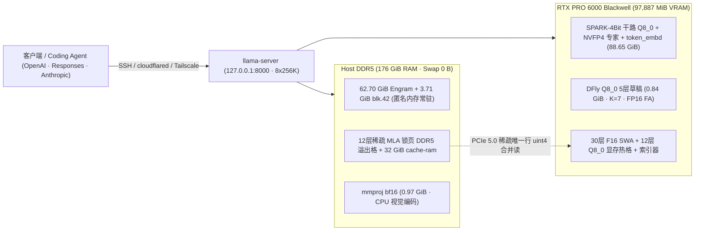

# hy4-flash-colab-g4

在单张 Google Colab G4（`RTX PRO 6000 Blackwell Server Edition`，`97,887 MiB` VRAM，`176 GiB` DDR5 RAM）上源码编译并运行 Tencent Hy4-Flash 的部署脚本与 `llama.cpp` 补丁集。

服务端基于固定提交的 `llama.cpp`（`2cbca389f`）编译为单个 `llama-server` 二进制（静态链接 `ggml`/`llama`），不依赖容器或 Python 推理框架：加载清洁 `SPARK-4Bit` 主权重、外置 5 层 `DFly` 投机草稿（`K=7`，原生 FP16 FlashAttention）与 CPU 视觉投影器，通过显存 + 锁页 DDR5 分层 KV 支持 `8 × 256K` 并发上下文，并在同一 `:8000` 端口同时提供 OpenAI Chat Completions、OpenAI Responses 与 Anthropic Messages 三套接口。

本仓库仅负责云端 G4 实例内的编译、权重拉取与服务启动，不绑定本地操作系统或特定隧道工具。若通过 Claude Code、Codex、Cursor、OpenCode 等 Coding Agent 自动部署，先为 Agent 准备好一台 Colab G4 的 shell 访问权限，再发送以下指令即可（Agent 执行细则见 [`AGENTS.md`](AGENTS.md)）：

```text
阅读 https://github.com/MELODY-TOYS/hy4-flash-colab-g4 的 README.md 和 AGENTS.md，在我提供的 Colab G4 运行时上后台部署 Tencent Hy4-Flash，就绪后把接入配置发给我。
```

---

## 环境要求与成本说明

- 硬件规格：需要分配到 Colab G4 GPU（`RTX PRO 6000 Blackwell`，`sm_120a`，`97,887 MiB / 95.59 GiB` VRAM，`176 GiB` DDR5 RAM，`/content` 可用空间 `≥ 154 GiB`）。同等规格的裸机 Linux（96 GiB Blackwell `sm_120`、主机内存 `≥ 176 GiB`、`CUDA ≥ 12.8`）同样适用。
- 冷启动耗时与 CU 消耗：首次完整部署包含源码编译（`2–5 分钟`）、下载 `153.16 GiB` 权重（`5–10 分钟`）和全量载入匿名内存（`11–24 分钟`）。Colab G4 计费约为 `10–11.2 CU/hr`，首次冷启动在生成首个 token 前约消耗 `3.5–9 CU`。
- 临时磁盘与连接保活：Colab 运行时空闲回收或手动删除后，`/content` 下的二进制与权重会一并清空。若仅通过网页 Notebook 长时间使用，需保持页面活跃或开启 Colab Pro+ 后台执行（Background execution）。
- Hugging Face 下载：权重拉取自公开仓库 [`AngelSlim/Hy4-flash-GGUF`](https://huggingface.co/AngelSlim/Hy4-flash-GGUF)，无需申请权限；如遇匿名限流，可按需设置 `HF_TOKEN`。

---

## 资源布局与实测性能

### 硬件与内存分配

| 项目 | 配置 | 说明 |
| --- | --- | --- |
| 目标硬件 | Colab G4（`RTX PRO 6000 Blackwell`, `sm_120a`） | `97,887 MiB`（`95.59 GiB`）VRAM，`176 GiB` DDR5 RAM，PCIe 5.0；`/content` 可用空间需 `≥ 154 GiB` |
| 推理程序 | 单文件 `llama-server`（约 `82 MiB`） | 基于 `llama.cpp` `2cbca389f` + 两层补丁，静态链接 `ggml`/`llama` |
| 模型权重 | `Hy4-flash-SPARK-4Bit.gguf`（`151.35 GiB`）<br>`hy4-flash_dfly_Q8_0.gguf`（`0.84 GiB`）<br>`mmproj-Hy4-flash-bf16.gguf`（`0.97 GiB`） | 选用干路 `Q8_0` + `NVFP4` 路由专家的清洁 `SPARK-4Bit` 权重（不使用有精度漂移的 `Fast` 变体）；三份权重共 `153.16 GiB`，加 `0.08 GiB` 二进制总计 `153.24 GiB`（`du -sh` 约 `154G`） |
| 权重切分 | GPU：`88.65 GiB`（干路 + 路由专家 + `token_embd`）+ `0.84 GiB` `DFly`<br>CPU：`62.70 GiB` Engram + `3.71 GiB` `blk.42` + `0.97 GiB` `mmproj` | `--load-mode none --lazy-mode off` 将 CPU 侧 Engram 词表读入不可换出的匿名内存，避免 mmap 页缓存被驱逐引发缺页掉速；`mmproj` 走 `--no-mmproj-offload` 驻留 CPU，不占显存 |
| 分层 KV 与并发 | `-kvu -np 8 --kv-unified-per-slot 262144 -ctk q8_0 -ctv q8_0 --cache-ram 32768` | 30 层滑窗 SWA-512 以 `F16` 驻显存（约 `283 MiB`）；12 层全局稀疏 MLA 拆分为显存热格与 2MB THP 锁页 DDR5 溢出格，经 PCIe 5.0 稀疏唯一行合并拉回显存；闲置长会话由 `32 GiB` 内存池缓存复用 |
| 投机解码 | `--spec-type draft-dfly --spec-draft-n-max 7` + 原生 FP16 FlashAttention | 外置 5 层 `DFly` 无额外 KV 占用，单次合批出草稿；`K=7`（`W=8`）对齐 Blackwell `NVFP4 MMVQ_MAX_BATCH_SIZE=8` 快路径上限，配合存活行延迟归一化与 576/512 原生 FP16 FA 算子 |
| 稳态水位 | VRAM：`94,887–95,141 / 97,887 MiB`（`92.66–92.91 / 95.59 GiB`）<br>Host RAM：约 `91 GiB used / 85 GiB available`，Swap `0 B` | `nvidia-smi` 实报可用显存余量 `2,110–2,364 MiB`，另有约 `636 MiB` 为驱动保留 |



### 实测性能

测试环境为 Colab G4（`RTX PRO 6000 Blackwell`, `sm_120a`），启用完整补丁（含优化 A/B）、视觉、`K=7` 与 `DFly attention = FA on`。标 `*` 的两项为合入优化 A/B 之前在同一补丁栈上的满窗压测记录：

| 场景 | 吞吐 / 延迟 | 观测结果 |
| --- | --- | --- |
| 单路代码生成（`no_think`, `K=7`） | `177.5–206.1 t/s` | 平均 `5.04 tok/轮`，单轮耗时 `28.5 ms` |
| 单路中文技术解析（`no_think`, `K=7`） | `104.8 t/s` | 平均 `3.01 tok/轮`，单轮耗时 `28.8 ms` |
| 8 路并发（8 × 256 tok 不同题材, `K=7`） | 聚合 `254.1 t/s` | 单路平均 `43.1 t/s`（`36.5–50.8 t/s`），共 2,048 tok 墙钟 `8.06s` |
| 106K 长上下文（60% 深度大海捞针, `K=7`） | Prefill `4,123.7 t/s`（`25.8s`）<br>Decode `30.5 ms/轮` | 准确召回；续问命中 `cache_n = 106,598` 耗时 `184 ms` |
| 单路 256K 满窗（260,550 tok）\* | Prefill `69.7s`（`3,740 t/s`） | 准确召回；`--jinja` 多轮 `tool_choice="auto"` 正常 |
| 8 × 256K 满并发（共 `209.7 万` KV 格）\* | 单轮 `87.7–92.8 ms` | 无 OOM，显存 + 锁页 DDR5 分层运行正常，Swap `0 B` |
| 视觉多模态与续问 KV 复用 | 首图 `0.8–2.2s` / `127–165 t/s`<br>带图续问 `166.7 t/s` | `mmproj` 跑在 CPU 不占显存，续问命中 `cache_n` 且 `DFly` 全程无报错 |
| DFly 连续投机（3,293+ 次 propose） | `no_snapshot=0`, `bad_snapshot=0`, `bad_token=0` | 优化 A 缩短 `9.4×` CPU 快照归一化耗时；优化 B 使 8 路草稿注意力提速 `1.27–1.29×` 并省 `15–19 MiB` 显存 |

---

## 快速开始

### 1. 启动后台部署

在 [colab.research.google.com](https://colab.research.google.com) 将运行时硬件切换为 G4 GPU（或通过 `google-colab-cli` 等工具连接已有 G4 实例）。

仓库设为 Private 期间，在 Colab 中克隆请使用只读、短期有效的 GitHub PAT，克隆后顺手清除写入 `.git/config` 的令牌（或直接将仓库打包上传解压至 `/content/hy4-flash-colab-g4`）；仓库公开后可直接匿名克隆：

```bash
git clone https://<GITHUB_PAT>@github.com/MELODY-TOYS/hy4-flash-colab-g4.git /content/hy4-flash-colab-g4
git -C /content/hy4-flash-colab-g4 remote set-url origin https://github.com/MELODY-TOYS/hy4-flash-colab-g4.git
```

在 G4 终端或 Notebook 单元格中以 `setsid nohup` 后台启动部署脚本，并用 `>>` 追加日志。默认无需手动指定 `HY4_API_KEY`，脚本会自动生成随机密钥并持久化保存到 `/content/.hy4-g4/api_key`（权限 `0600`），重跑时自动复用。

在 G4 Shell / SSH 终端中执行：

```bash
git clone https://github.com/MELODY-TOYS/hy4-flash-colab-g4.git /content/hy4-flash-colab-g4
mkdir -p /content/.hy4-g4

# 可选：自定义 API Key（默认留空，由脚本自动生成并持久化到 /content/.hy4-g4/api_key）
# export HY4_API_KEY="sk-$(openssl rand -hex 24)"
# 可选：遇到 Hugging Face 匿名下载限流时再取消注释
# export HF_TOKEN="hf_..."

setsid nohup bash /content/hy4-flash-colab-g4/scripts/bootstrap-hy4.sh \
  >> /content/.hy4-g4/bootstrap.log 2>&1 < /dev/null &
```

或在 Colab Notebook 单元格中运行：

```python
%%bash
set -euo pipefail
REPO_URL="https://github.com/MELODY-TOYS/hy4-flash-colab-g4.git"
# 私有仓库期间改为 REPO_URL="https://<GITHUB_PAT>@github.com/MELODY-TOYS/hy4-flash-colab-g4.git"，克隆后执行 git remote set-url 清除令牌

if [ -d /content/hy4-flash-colab-g4/.git ]; then
  git -C /content/hy4-flash-colab-g4 pull --ff-only || true
elif [ ! -d /content/hy4-flash-colab-g4 ]; then
  git clone "${REPO_URL}" /content/hy4-flash-colab-g4
fi
mkdir -p /content/.hy4-g4

# 默认留空 HY4_API_KEY，由脚本自动生成并持久化到 /content/.hy4-g4/api_key (0600)
# export HY4_API_KEY="sk-$(openssl rand -hex 24)"
# export HF_TOKEN="hf_..."

setsid nohup bash /content/hy4-flash-colab-g4/scripts/bootstrap-hy4.sh \
  >> /content/.hy4-g4/bootstrap.log 2>&1 < /dev/null &
echo "Bootstrap started in background. Poll /content/.hy4-g4/state.json and /content/.hy4-g4/bootstrap.log"
```

[`scripts/bootstrap-hy4.sh`](scripts/bootstrap-hy4.sh) 会按顺序幂等执行 4 个阶段（状态写入 `/content/.hy4-g4/state.json`，脚本日志在 `/content/.hy4-g4/bootstrap.log`，服务端日志在 `/tmp/hy4-server.log`）：

1. 环境校验（`< 15s`）：检查 GPU 显存 `≥ 94,000 MiB`、精确算力 `12.0`（`sm_120a`）、主机总内存 `≥ 165 GiB`、`nvcc ≥ 12.8` 及 `/content` 净剩余空间；不满足条件立即写入 `error` 退出。
2. 源码编译（`2–5 分钟`）：拉取 `llama.cpp` 固定提交 `2cbca389f515df455412dafa07e2b1359cc72a6d`，依次应用 [`patches/`](patches/) 下的两层补丁，在 `/tmp`（空间不足时切至 `/dev/shm`）编译出单文件 `/content/hy4-bin/llama-server`（约 `82 MiB`）并清理构建目录。
3. 权重下载（`5–10 分钟`）：调用 [`scripts/download_gguf.py`](scripts/download_gguf.py) 预检磁盘空间后并发 HTTP 206 下载 `DFly`、`mmproj` 与 `SPARK-4Bit` 权重，支持断点续传与已完整文件跳过（设 `HY4_VERIFY_SHA=1` 可校验 `X-Linked-ETag` SHA-256）。
4. 加载与启动（`11–24 分钟`）：将生效密钥写入 `/content/.hy4-g4/api_key`（`0600`），通过 `LLAMA_API_KEY` 环境变量传入（不出现在 `ps` 命令行参数中），以 `--load-mode none --lazy-mode off` 装载权重，每 10 秒向 `state.json` 更新已耗时与显存水位，就绪后校验主机剩余可用内存满足 `--cache-ram` 加 `12 GiB` 预留余量。

### 2. 查看进度与获取密钥

轮询进度，直至 `state.json` 中的 `status` 变为 `"ready"`（若失败则为 `"error"`），随后读取自动生成的 API Key：

```bash
cat /content/.hy4-g4/state.json
tail -n 30 /content/.hy4-g4/bootstrap.log

# status 变为 "ready" 后，读取客户端接入所需的 API Key
cat /content/.hy4-g4/api_key
```

### 3. 转发或暴露端口

`llama-server` 默认监听云端 `127.0.0.1:8000`（避开 Colab 内部占用的 `:8080`）。按使用环境将 `127.0.0.1:8000` 转发或暴露给客户端即可：

- SSH 或组网通道：直接做本地端口转发 `-L 127.0.0.1:8000:127.0.0.1:8000`。若使用 `google-colab-cli` 的 `colab ssh`，注意同一实例只允许一条活跃 SSH 会话，并发新建连接会返回 `HTTP 429`，需同时执行命令和端口转发时请复用单条连接。
- 网页 Notebook 临时 HTTPS 隧道：在单元格中后台启动 `cloudflared`（脚本会在启动前校验 `/content/.hy4-g4/api_key` 非空，且不在单元格输出中打印密钥内容，避免随 `.ipynb` 保存进网盘）：

```python
%%bash
set -euo pipefail
if [ ! -s /content/.hy4-g4/api_key ]; then
  echo "ERROR: /content/.hy4-g4/api_key is missing or empty; refusing to expose unauthenticated server to the public internet." >&2
  exit 1
fi
if [ ! -x /usr/local/bin/cloudflared ]; then
  curl -fsSL -o /usr/local/bin/cloudflared \
    https://github.com/cloudflare/cloudflared/releases/latest/download/cloudflared-linux-amd64
  chmod +x /usr/local/bin/cloudflared
fi
pkill -f "cloudflared tunnel.*127\.0\.0\.1:8000" 2>/dev/null || true
setsid nohup /usr/local/bin/cloudflared tunnel --no-autoupdate --url http://127.0.0.1:8000 \
  > /content/.hy4-g4/cloudflared.log 2>&1 < /dev/null &

for _ in $(seq 1 20); do
  URL="$(grep -oE 'https://[a-zA-Z0-9.-]+\.trycloudflare\.com' /content/.hy4-g4/cloudflared.log | head -n 1 || true)"
  if [ -n "${URL}" ]; then
    echo "Public Tunnel URL: ${URL}"
    echo "API key file (0600, not printed to avoid saving into .ipynb): /content/.hy4-g4/api_key"
    exit 0
  fi
  sleep 1
done
echo "Timed out waiting for trycloudflare URL; inspect /content/.hy4-g4/cloudflared.log" >&2
tail -n 20 /content/.hy4-g4/cloudflared.log >&2
exit 1
```

Cloudflare 免费快速隧道的单次请求源站超时约为 `100 秒`，超过 `128K` 的非流式冷 Prefill 可能触发 `HTTP 524`，使用该隧道时请在客户端开启流式输出（`stream: true`）。

---

## 客户端配置

`:8000` 端口同时提供以下三套协议（Model ID：`hy4-flash`，单路上下文上限：`262144`）：

| 协议 | Base URL | 端点 | 鉴权头 |
| --- | --- | --- | --- |
| OpenAI Chat Completions | `http://<HOST>:8000/v1` | `POST /v1/chat/completions` | `Authorization: Bearer <KEY>` |
| OpenAI Responses API（Codex 等） | `http://<HOST>:8000/v1` | `POST /v1/responses` | `Authorization: Bearer <KEY>` |
| Anthropic Messages API（Claude Code 等） | `http://<HOST>:8000`（末尾不带 `/v1`） | `POST /v1/messages` | `x-api-key: <KEY>` + `anthropic-version: 2023-06-01` |

实测范围说明：三套底层协议均已在 Colab G4 实机端到端验证通过，Codex CLI 已完成真实多模态与思考实机接入验收；Claude Code 及其他客户端按下方标准协议字段填入即可。请将 `<YOUR_API_KEY>` 替换为云端 `cat /content/.hy4-g4/api_key` 的输出（若使用 `cloudflared`，将 `http://127.0.0.1:8000` 替换为隧道 HTTPS 地址）。

### 1. Claude Code

```bash
export ANTHROPIC_BASE_URL="http://127.0.0.1:8000"   # 末尾不带 /v1
export ANTHROPIC_API_KEY="<YOUR_API_KEY>"
# 若本地同时登录过 Anthropic 官方账号触发鉴权冲突，可改用 ANTHROPIC_AUTH_TOKEN 替代 ANTHROPIC_API_KEY
export ANTHROPIC_MODEL="hy4-flash"
```

### 2. Codex CLI（`~/.codex/config.toml`）

先在运行 Codex 的终端环境变量中设置 `export HY4_API_KEY="<YOUR_API_KEY>"`，再写入 `~/.codex/config.toml`：

```toml
model = "hy4-flash"
model_provider = "hy4_g4"
# 必须设置：Codex 默认发送 medium，会触发模型模板报错 HTTP 400（仅支持 low / high / max）
model_reasoning_effort = "high"

[model_providers.hy4_g4]
name = "Hy4-Flash Colab G4"
base_url = "http://127.0.0.1:8000/v1"
wire_api = "responses"
env_key = "HY4_API_KEY"
```

### 3. 通用 OpenAI 兼容客户端

- Base URL：`http://127.0.0.1:8000/v1`
- API Key：`<YOUR_API_KEY>`（来自云端 `cat /content/.hy4-g4/api_key`）
- Model ID：`hy4-flash`
- Context Window：`262144`
- 关闭思考：在请求体附加 `"chat_template_kwargs": {"reasoning_effort": "no_think"}`（`/v1/chat/completions` 也支持顶层 `"reasoning_effort": "no_think"`）。

### 请求参数说明

1. `reasoning_effort` 取值约束：模型 Jinja 模板仅支持 `no_think`、`low`、`high`（默认）、`max` 四档。禁止传入 `"medium"` 或 `"xhigh"`，否则模板解析会直接返回 `HTTP 400`；也不要用 `"none"` 关闭思考，`llama-server` 会忽略 `"none"` 并回退为默认的 `"high"`，关闭思考请传 `"no_think"`。
2. 采样参数：GGUF 已内置官方默认采样参数，客户端留空即可；经第三方网关转发时请勿强行注入 `presence_penalty=1.0`，否则易引发重复退化。
3. 本机代理与超时：若客户端所在机器开启了 HTTP 代理，访问 `127.0.0.1` 或内网转发地址时需配置 `NO_PROXY`。`128K` 冷 Prefill 约需 `32s`、`256K` 约需 `70s`，建议将客户端读超时设为 `≥ 180s`（256K 场景建议 `300s`）。

---

## 关键机制与注意事项

1. `--load-mode none` 与 11–24 分钟加载耗时：模型每生成一个 token 都要访问 `62.70 GiB` 的 CPU Engram 表。若使用默认的 `mmap`，该表落在可回收页缓存中；当 `--cache-ram` 与分层 KV 推高匿名内存后，内核会驱逐冷门 Engram 页面，触发每秒数百次磁盘主缺页，单路延迟从约 `30 ms/轮` 跌至 `350 ms/轮`（约 `10 t/s`）。`--load-mode none --lazy-mode off` 在启动时将 Engram 读入进程匿名内存（Colab Swap 为 `0`，运行期不会换出）。刚下完权重趁页缓存尚热启动约 `11 分钟`，冷盘重启约 `20–24 分钟`。
2. `-ot` 权重切分规则：脚本传入的三条切分表达式均不可省略：
   - `^token_embd\.weight$=CUDA0`：外置 `DFly` 草稿与主干共享 GPU 词嵌入，落回 CPU 会导致草稿绑定失败；
   - `^per_layer_token_embd\.weight$=CPU`：将 `62.70 GiB` Engram 表放入主机内存；
   - `^blk\.42\..*=CPU`：将主 GGUF 内置的第 42 层 MTP 头移出显存，腾出 `3.71 GiB` VRAM。
3. CUDA 环境变量冲突：保持脚本内置的 `GGML_CUDA_MOE_CONCURRENT=1` 与 `GGML_CUDA_GRAPH_OPT=1`；不要将 `GGML_CUDA_REUSE_Q8=1` 与 `GGML_CUDA_GRAPH_OPT=1` 同时开启，两者叠加在多并发下会掉速约 10% 并引入贪心漂移。
4. CPU 视觉编码特征：`mmproj` 运行在 CPU 上不占显存，首次输入大图编码耗时约 `0.8–2.2s`（期间会短暂同步占用主循环）；带图续问命中 Prompt Cache 后可直接复用。纯文本场景可设 `HY4_ENABLE_VISION=0` 跳过视觉模块。
5. 监听端口与幂等锁：Colab 运行时内部占用 `:8080`，服务固定绑定 `:8000`。`bootstrap-hy4.sh` 通过 `flock` 互斥（并发重跑返回退出码 `75`）；若检测到托管的 `llama-server` 正在加载权重（`/health` 返回 `503`），默认会自动挂载等待就绪而非杀掉重来，如需强制重启请设 `HY4_FORCE_RESTART=1`。完整环境变量列表见 [`AGENTS.md`](AGENTS.md)。
6. `/dev/shm` 挂载 `noexec`：Colab 的 `/dev/shm` 不允许直接执行二进制。`bootstrap-hy4.sh` 在 `/dev/shm` 编译后会自动 `strip` 并将 `llama-server` 安装到 `/content/hy4-bin/`，不受影响。
7. 实例停机与计费核对：关闭浏览器标签页、断开 SSH 隧道或停止 `cloudflared` 不会停止 Colab G4 计费（约 `10–11.2 CU/hr`）。用完后请在 Colab 网页端执行「断开连接并删除运行时」（或使用 `colab stop -s <name>` 配合 `colab sessions` 核对），并到 Colab 的 Compute Units / Usage 页面确认已无活跃计费实例。

---

## 补丁说明

基于 `ggml-org/llama.cpp` 固定提交 `2cbca389f515df455412dafa07e2b1359cc72a6d`：

1. [`patches/01-angelslim-hy4-flash-spark.patch.gz`](patches/01-angelslim-hy4-flash-spark.patch.gz)：衍生自上游 AngelSlim [`hy4-flash-spark.patch`](https://huggingface.co/AngelSlim/Hy4-flash-GGUF/blob/main/patch/hy4-flash-spark.patch)（移除了单文件构建未使用的 3 个 `tests/dfly-server/` 测试文件），提供 Hy4-Flash 模型架构、SPARK `NVFP4` 算子与外置 `DFly` 基础框架。
2. [`patches/02-hy4-flash-g4.patch`](patches/02-hy4-flash-g4.patch)：面向单卡 96 GiB Blackwell 的增量工程改动：
   - 显存 + 锁页 DDR5 分层 KV 与紧凑池化索引器，单卡 96 GiB 容纳 `8 × 256K`（`209.7 万` KV 格）；
   - PCIe 5.0 稀疏唯一行 `uint4` 合并暂存：仅拉取 `top-2048` 去重命中行（实测约 `46 GB/s`），未溢出显存热区时直接旁路；
   - `F16` SWA-512 + `Q8_0` Full MLA 混合精度 KV，并在 `Q8_0` KV 下支持 `DFly` 多槽合批投机与 O(1) 回滚；
   - 放行 `--mmproj` 视觉多模态与 `DFly` 投机解码共存；
   - 优化 A（DFly 存活行延迟归一化）：将快照拉取延后至 `post_decode()` 采样完成、KV 尾回滚前，每路仅归一化存活的 1 个 anchor 行，并用 O(1) 纪元数组替代 `std::unordered_set`（`256K / 8 路` CPU 快照归一化提速 `9.4×`）；
   - 优化 B（草稿 5 层原生 FP16 FlashAttention）：针对 `DKQ=576, DV=512, n_head % 16 == 0` 启用 `ggml_flash_attn_ext`（`V_is_K_view=true`，`N_pad % 256 == 0`，`W_pad % 16 == 0` 填 `-INF` 防止 `scan_mask` 越界，修复图复用校验），8 路草稿注意力提速 `1.27–1.29×` 并节省 `15–19 MiB` 显存。

---

## 目录结构

```text
.
├── README.md                                  # 部署说明、客户端配置与实现细节
├── AGENTS.md                                  # 面向 AI Coding Agent 的云端执行与排障手册
├── LICENSE                                    # MIT License 及上游补丁/权重分层许可声明
├── LICENSES/
│   └── Tencent-Hy-License-1.0.txt             # Tencent Hy License, Version 1.0 全文
├── scripts/
│   ├── bootstrap-hy4.sh                       # Colab G4 幂等校验、编译、下载与启动脚本
│   └── download_gguf.py                       # 带磁盘预检与可选 SHA-256 校验的断点续传下载器
└── patches/
    ├── 01-angelslim-hy4-flash-spark.patch.gz  # 上游 AngelSlim 基础补丁衍生包
    └── 02-hy4-flash-g4.patch                  # Colab G4 单卡 96 GiB 增量补丁
```

## 许可证

详见 [`LICENSE`](LICENSE) 与 [`LICENSES/Tencent-Hy-License-1.0.txt`](LICENSES/Tencent-Hy-License-1.0.txt)：

- 本仓库原创脚本（`scripts/`）、文档（`README.md`、`AGENTS.md`）及 `patches/02-hy4-flash-g4.patch` 中的增量修改按 MIT License 开源。
- 上游引擎 [`ggml-org/llama.cpp`](https://github.com/ggml-org/llama.cpp)（Copyright The ggml authors）采用 MIT License。
- [`patches/01-angelslim-hy4-flash-spark.patch.gz`](patches/01-angelslim-hy4-flash-spark.patch.gz) 衍生自 [`AngelSlim/Hy4-flash-GGUF`](https://huggingface.co/AngelSlim/Hy4-flash-GGUF/blob/main/patch/hy4-flash-spark.patch)，与部署时从 Hugging Face 拉取的模型权重共同受 Tencent Hy License, Version 1.0（全文见 [`LICENSES/Tencent-Hy-License-1.0.txt`](LICENSES/Tencent-Hy-License-1.0.txt)）约束；合并应用两层补丁编译出的二进制或源码树同时受 MIT License 与 Tencent Hy License, Version 1.0 约束。
- 商用合规提示：Tencent Hy License, Version 1.0 第 10 条包含针对大规模 Model-as-a-Service（MaaS）商业 API 服务的额外授权条款；如用于大规模对外商用 API 托管，请先审阅该条款确认授权要求。本仓库不分发任何模型权重。
